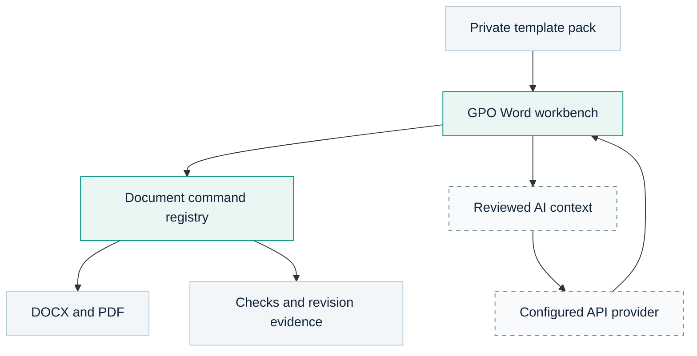

<p align="center">
  
</p>
<h1 align="center">GPO Word</h1>
<p align="center"><strong>Structured documents. Consistent language. Clear revision history.</strong></p>
<p align="center">A Windows document authoring workspace for Thai pharmaceutical documentation.</p>
<p align="center">
  <a href="docs/windows-build.md">Build on Windows</a> ·
  <a href="GOAL.md">Product goals</a> ·
  <a href="PLAN.md">Delivery plan</a> ·
  <a href="HANDOFF.md">Developer handoff</a> ·
  <a href="VALIDATION.md">Validation status</a> ·
  <a href="docs/manual/th/README.md">User guide (Thai)</a>
</p>

> **Windows preview.** The portable package includes a locally built executable. Synthetic startup, document, batch and PDF checks passed in development builds, and the current source passed local CI. Representative private-template fidelity remains unverified. See [VALIDATION.md](VALIDATION.md) before operational use.

GPO Word adapts [KhianKrub](https://github.com/chanonss/khiankrub) and [WordCraft](https://github.com/storytold/wordcraft) for teams preparing work instructions, policies, forms, logbooks, specifications, procurement documents and internal memoranda. It combines a native editor with editable template packs, deterministic document checks and optional AI drafting. The GPO ribbon tab opens task controls in a docked pane alongside the document. Optional start actions, save/check status, searchable template text previews, grouped findings, CSV mapping and an exact AI request preview keep routine work close to the editor.

The public repository contains code, documentation and synthetic examples. This local all-in-one ZIP also includes a private template pack under gitignored docsStorage. Keep that directory out of public Git commits; completed documents and API keys are not bundled. This is an independent project; the project name and new logo do not imply endorsement by the Government Pharmaceutical Organization or either upstream project.

## What the workspace is designed to do

| Workflow | GPO-specific implementation in this source | Validation still required |
| --- | --- | --- |
| Structured authoring | Real Head 01–09 paragraph styles, linked multilevel numbering and outline levels | Renumbering, save/reopen and Word round trips |
| Template management | Relative paths, profile/version settings, required headings and selected-text field binding | Header fidelity and usability of routine no-code edits |
| Revision control support | Compare text and selected style metadata, prepare an AI summary and append a reviewed history row | Representative revisions, table matching and preservation of old history |
| Consistent terminology | Editable term rules and common spelling checks | An owner-approved GMP/GPO glossary |
| PDF distribution | Optional custom text watermark on an exported document copy | Pagination, Thai rendering and watermark placement |
| Structure checks | Required headings, reference-code syntax and unresolved placeholders | Profile accuracy; syntax does not prove registry existence or validity |
| Batch FM/LG generation | CSV-driven field replacement, one DOCX per record and overwrite protection | A 20-machine batch, fields split across runs and output inspection |
| Thai utilities | Buddhist Era dates, Thai/Arabic digits and Thai baht wording | Calendar boundaries and representative financial amounts |
| Optional AI assistance | Configurable API endpoint/model, explicit text preview and Windows DPAPI key storage | Provider connectivity, error handling and normal Windows-profile behavior |

These are implementation claims, not test-pass claims. See [VALIDATION.md](VALIDATION.md) for the evidence boundary.

## Document families

| Profile | Intended use |
| --- | --- |
| WI | Work Instruction |
| QP | Quality Policy; confirm the local classification with the document owner |
| FM | Form |
| LG | Logbook: a template cover followed by user-authored tables |
| SP | Specification |
| INDEX | Document index / equipment list |
| EXAM | Training questionnaire |
| OJT | On-the-job training; a dedicated source template is still needed |
| TOR | Terms of Reference; a dedicated source template is still needed |
| MEMO | Internal memorandum: template header plus independently authored content |

The selected template is the authority for its layout. A generic profile must not be presented as an approved organization format.

## Build on your home or development PC

Install the MSVC C++ Build Tools with the **Desktop development with C++** workload and a Windows SDK, then install Rust through rustup. This workspace declares Rust **1.95** as its minimum version. Restart the terminal after installation.

From the repository root:

```powershell
rustup update stable
rustup default stable
rustup component add rustfmt clippy
rustup target add wasm32-unknown-unknown
cargo test -p wordcraft-engine --test gpo
```

Resolve any failures before continuing:

```powershell
cargo xtask ci
cargo build --release -p wordcraft -p wordcraft-cli
```

Build output is `target\release\wordcraft.exe`. The package script renames the application to `GPOWord.exe`. The supplied Windows executable was built with the release profile.

For setup, PowerShell policy handling and troubleshooting, use [the Windows build guide](docs/windows-build.md). VS Code is an editor, not a substitute for the Rust and C++ toolchains.

## Add your private templates

This all-in-one ZIP already includes the private template pack in `docsStorage`, with `catalog.json` and `pack.json` directly inside it. The folder is gitignored; no separate extraction is needed.

The current private pack contains 15 copied source templates and one memorandum-header preset. It is a curated selection from a larger local reference folder, not a copy of every reference document. It does not contain completed memorandum bodies. It supplies no dedicated OJT or TOR template.

Choose the template location in Settings, or place `docsStorage` beside the portable executable. Keep revised template files inside docsStorage before selecting them so their relative paths remain portable. Template paths remain relative so the pack can move between PCs. Font names do not install fonts: install appropriately licensed Thai fonts on each machine where exact appearance is required.

Routine field binding, profile text, terminology, font and heading changes are available through the GPO ribbon and its docked task pane. A changed table or header layout still needs a revised template in the editor; arbitrary layout migration is not automatic.

## Optional AI drafting

The source default is the OpenAI-compatible endpoint `https://api.opentyphoon.ai/v1` and model identifier `typhoon-v2.5-30b-a3b-instruct`. These are configurable defaults, not a guarantee of current model availability, free quotas or provider terms.

Enter a key locally in Settings. Review the text selected for transmission, request a draft and review the answer before insertion. There is no intended automatic call on file open, automatic paid-provider fallback or hidden retry loop.

On Windows, persisted keys use current-user DPAPI and are bound to the configured endpoint. If secure persistence fails, the source retains a session-only key rather than writing plaintext. A real provider call and DPAPI storage still need verification.

## Create a portable team package

After the build, checks and document smoke tests pass:

```powershell
powershell -NoProfile -ExecutionPolicy RemoteSigned -File .\scripts\Package-Portable.ps1
```

The default output is `dist\GPOWord-portable.zip`. It contains the executable, selected template pack, licenses, a portable marker and empty data/document folders. It deliberately excludes existing settings and API keys.

A work PC does not need Rust or the C++ build tools to use a compatible built application. Organization application-control rules still apply to executables. A source ZIP cannot be launched as an application.

## Architecture



The GPO workbench stays separate from the upstream document engine. Formatting, document checks, batch generation and export remain engine commands. AI operates on explicitly reviewed context; deterministic date, numbering and amount utilities do not need a model.

See [the GPO architecture notes](docs/gpo-architecture.md) and the upstream [architecture documentation](docs/architecture.md).

## Repository map

- `apps/wordcraft/src/gpo.rs`: desktop workbench and AI settings.
- `apps/wordcraft/src/gpo_storage.rs`: portable storage and template resolution.
- `crates/engine/src/gpo.rs` and `cmd/gpo.rs`: GPO data, checks and commands.
- `gpo/`: default profiles, writing guidance and synthetic batch examples.
- `scripts/`: setup, launch and portable packaging.
- `docs/`: English project documentation and retained upstream engineering references.

Read [HANDOFF.md](HANDOFF.md) before continuing development. The language policy is [documented here](docs/documentation-language.md): project and engineering documentation is English; the owner-requested Thai user guide is in docs/manual/th. Thai document content, runtime language resources and Thai test fixtures remain supported.

## Upstream and licensing

The base is pinned in [gpo/upstreams.lock.json](gpo/upstreams.lock.json). Retained code and assets remain subject to their existing notices and licenses.

- [KhianKrub](https://github.com/chanonss/khiankrub), by Chanon Sarasuk.
- [WordCraft](https://github.com/storytold/wordcraft), by the upstream contributors.
- Project code: **MIT OR Apache-2.0**; see [LICENSE-MIT](LICENSE-MIT), [LICENSE-APACHE](LICENSE-APACHE), [NOTICE](NOTICE) and [ATTRIBUTION.md](ATTRIBUTION.md).

The README logo is project-specific artwork. Desktop executable icons still require deliberate integration and verification; they are not claimed to have been replaced by this documentation refresh.

## Author guide and local project location

Read the [Thai user guide](docs/manual/th/README.md) for template selection, heading styles, field binding, document checks, AI drafting, revision history, PDF watermarks and batch generation.

The intended local project folder is Desktop/myProject/gpo-word. Its private reference documents remain in the sibling gpoDocs/docsStorage folder. The source package includes scripts/Install-Desktop.ps1 to copy a prepared project to that Desktop location while preserving existing samples and unrelated files. Private templates stay gitignored.

The [offline Thai manual](docs/manual/th/index.html) can be opened directly in a browser without an internet connection.
