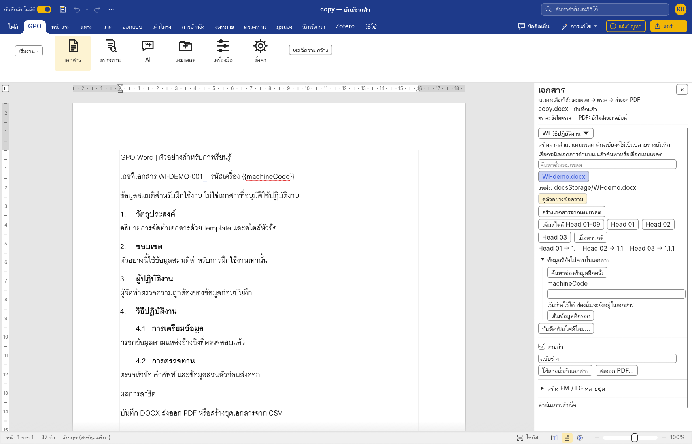
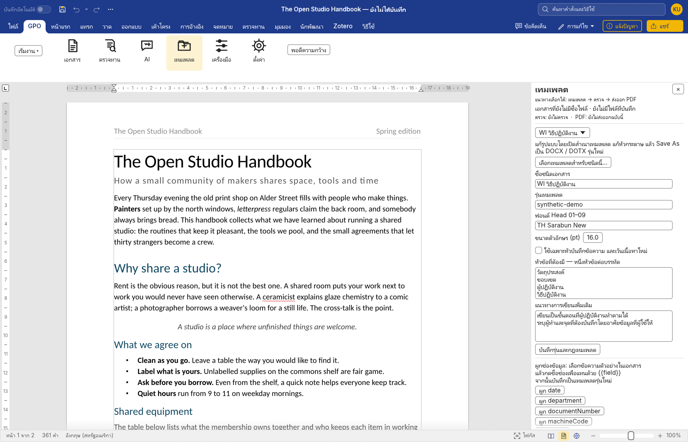
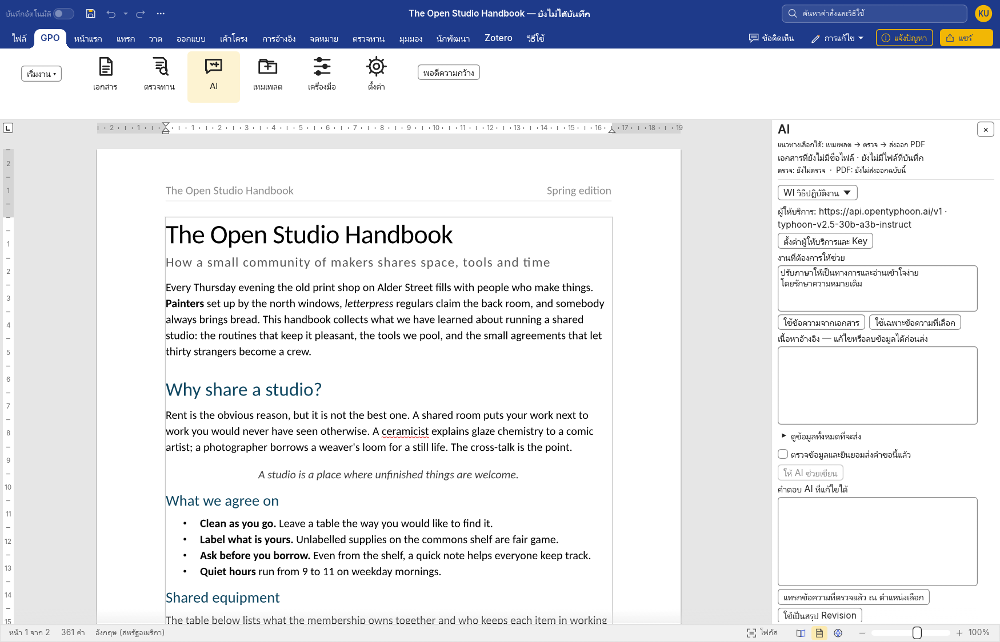
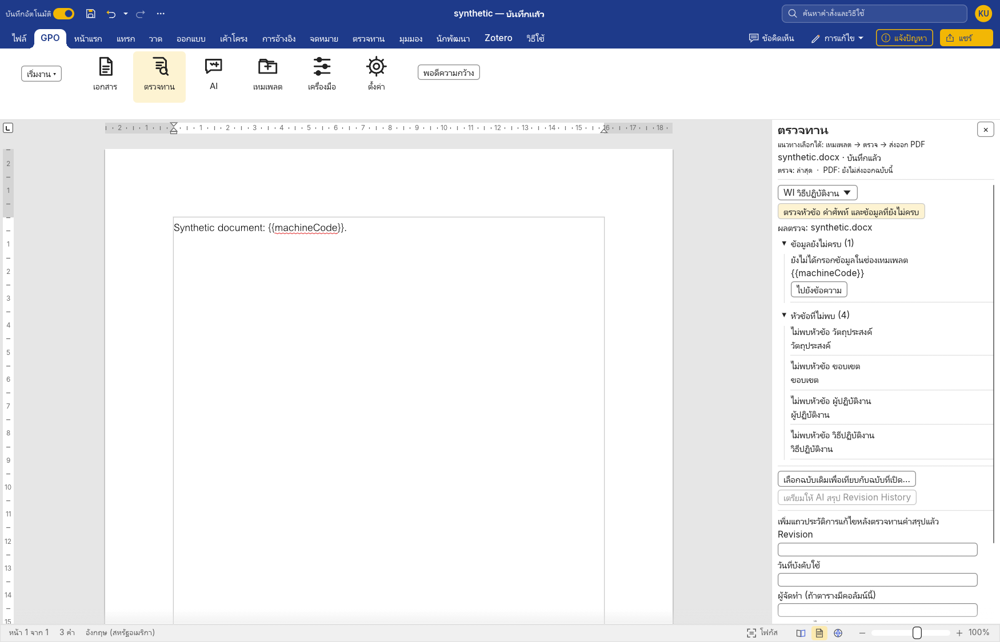
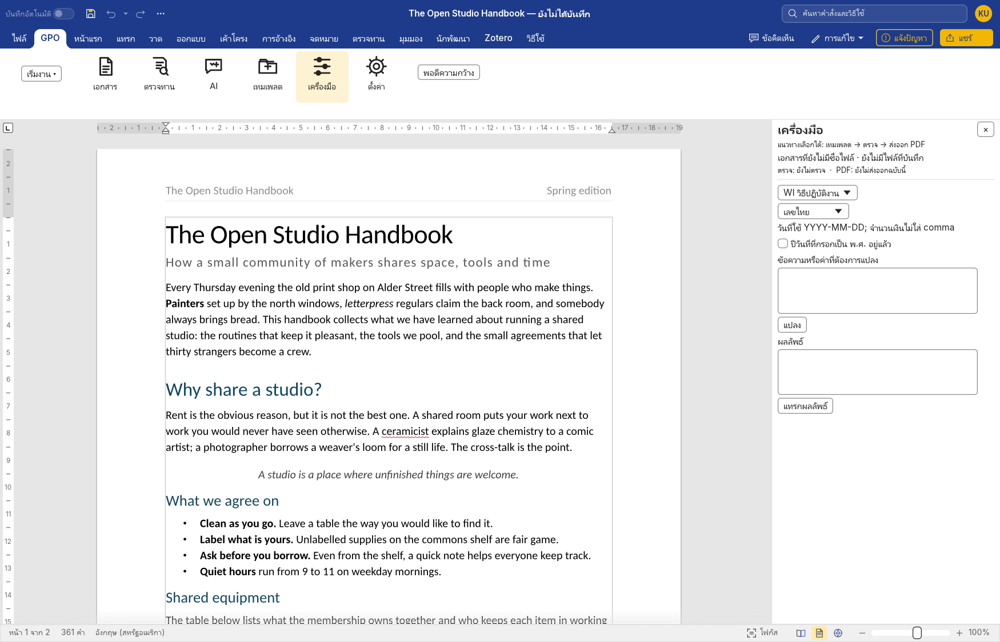

# คู่มือใช้งาน GPO Word

คู่มือนี้อธิบายการสร้างเอกสารจาก template การใช้หัวข้ออัตโนมัติ การตรวจทาน และการส่งออกไฟล์สำหรับผู้ใช้ Windows ส่วนเอกสารสำหรับนักพัฒนาใน repository ใช้ภาษาอังกฤษ

ภาพในคู่มือนี้ถ่ายจากแอป Windows โดยใช้เอกสารสมมติ ผลตรวจและขั้นตอนที่ยังไม่ได้ทดสอบอยู่ใน [VALIDATION.md](../../../VALIDATION.md)

## 1. เตรียมโฟลเดอร์และเปิดโปรแกรม

ชุดที่เปิดใช้ได้ต้องมี `GPOWord.exe` และโฟลเดอร์ `docsStorage` ซึ่งมี `catalog.json` และ `pack.json` อยู่ข้างใน ไฟล์ ZIP ที่มีเฉพาะซอร์สโค้ดจะยังเปิดเป็นโปรแกรมไม่ได้

การตั้งค่า GPO และ Key ที่เข้ารหัสเก็บใน `data` ส่วนการตั้งค่าตัวแก้ไขและไฟล์กู้คืนเก็บใน `data/editor` ของชุด portable การทำแพ็กแจกใหม่จะไม่รวมข้อมูลผู้ใช้เหล่านี้

แตก ZIP ทั้งชุดก่อน แล้วดับเบิลคลิก `GPOWord.exe` จากนั้นเลือกแท็บ **GPO** บนแถบด้านบน แล้วกด **เอกสาร**, **ตรวจทาน**, **AI**, **เทมเพลต**, **เครื่องมือ** หรือ **ตั้งค่า** เพื่อเปิดแผงงานด้านขวา หากปิดแผงไปแล้ว ให้กดปุ่มเดิมบนแถบ GPO เพื่อเปิดอีกครั้ง ถ้าหน้ากระดาษแสดงไม่ครบ ให้กด **พอดีความกว้าง** บนแถบ GPO หรือปิดแผงเพื่อเพิ่มพื้นที่เขียน ส่วนแผงที่มีรายการยาวสามารถเลื่อนลงได้



หากโปรแกรมยังไม่พบ template ให้เข้า **ตั้งค่า → โฟลเดอร์ docsStorage → เลือกโฟลเดอร์…** แล้วเลือกโฟลเดอร์ที่มี catalog โดยตรง ไม่ใช่โฟลเดอร์แม่

เอกสารต้นฉบับที่ใช้พัฒนาระบบเก็บแยกอยู่ใน `gpoDocs\docsStorage` ชุดแจกจะรวมเฉพาะ template ที่คัดเลือกไว้ ส่วนบันทึกข้อความฉบับเต็มและข้อมูลผู้ใช้เดิมไม่รวมในชุดแจก

## 2. สร้าง WI, QP, FM หรือ SP

1. เปิดหน้าต่าง **GPO Word** แล้วเลือกชนิดเอกสาร เช่น WI
2. ไปที่แผง **เอกสาร** เลือกชนิดเอกสาร ค้นหาชื่อ และเลือก template ให้ตรงกับงาน กด **ดูตัวอย่างข้อความ** เพื่อตรวจเนื้อหาเบื้องต้น แล้วกด **ซ่อนตัวอย่างข้อความ** เมื่อดูเสร็จ ภาพจัดหน้าอาจต่างจากข้อความตัวอย่าง
3. กด **สร้างเอกสารจากเทมเพลต**
4. ตรวจชื่อเอกสาร รหัส Revision หน่วยงาน และข้อมูลส่วนหัว
5. กด **บันทึกเป็นไฟล์ใหม่…** แล้วตั้งชื่อที่ยังไม่มีอยู่ ระบบจะไม่เขียนทับไฟล์เดิม

การสร้างเอกสารจาก template จะสร้างสำเนาสำหรับแก้ไข ไฟล์ต้นฉบับไม่ควรเป็นปลายทางบันทึกของเอกสารใหม่ ชื่อเอกสารและข้อมูลตัวอย่างใน template ต้องตรวจและเปลี่ยนให้ตรงกับงานทุกครั้ง

สำหรับ Logbook ให้เลือกแบบหน้าปกก่อน แล้วเพิ่มตารางในหน้าถัดไปตามลักษณะการบันทึก โดยใช้คำสั่ง **Insert → Table** ของตัวแก้ไขหลัก

ชุดต้นแบบที่ได้รับยังไม่มีแบบ OJT และ TOR โดยเฉพาะ หากจะใช้งานสองประเภทนี้ ต้องเลือก template ที่หน่วยงานใช้อยู่เพิ่มเติม ไม่ใช้แบบข้อสอบแทน OJT โดยอัตโนมัติ

## 3. ใช้ Head 01, Head 02 และเลขหัวข้อ

วางเคอร์เซอร์ในย่อหน้าที่เป็นหัวข้อ แล้วเลือก **เพิ่มสไตล์ Head 01–09** เพื่อให้เอกสารมีชุดสไตล์ จากนั้นกดระดับหัวข้อที่ต้องการ

| สไตล์ | ตัวอย่างเลข | ใช้กับ |
| --- | --- | --- |
| Head 01 | 1. | หัวข้อหลัก |
| Head 02 | 1.1 | หัวข้อย่อยระดับแรก |
| Head 03 | 1.1.1 | หัวข้อย่อยระดับถัดไป |
| เนื้อหาปกติ | ไม่มีเลขหัวข้อ | ย่อหน้าคำอธิบาย |

เลือกทั้งย่อหน้าหรือวางเคอร์เซอร์ในย่อหน้านั้นก่อนเปลี่ยนสไตล์ หลีกเลี่ยงการพิมพ์เลขหัวข้อนำหน้าด้วยมือ เพราะเลขที่พิมพ์เองจะไม่สัมพันธ์กับการเพิ่ม ลบ หรือย้ายหัวข้อ

หลังแก้ไขโครงสร้าง ให้ตรวจเลขบนหน้าและในแถบนำทาง แล้วบันทึก ปิด และเปิดไฟล์ใหม่เพื่อตรวจซ้ำ โดยเฉพาะเอกสารที่นำเข้าจาก DOC รุ่นเก่า

## 4. เติมข้อมูลซ้ำด้วยช่องข้อมูล

ช่องข้อมูลใช้รูปแบบ `{{ชื่อช่อง}}` เช่น `{{machineCode}}` หรือ `{{documentNumber}}` เมื่อตั้งค่าครั้งแรกแล้ว ผู้ใช้สามารถเติมข้อมูลโดยไม่ต้องค้นหาและแก้ข้อความทุกตำแหน่งด้วยตนเอง

การผูกช่องข้อมูล:

1. เปิดสำเนา template ที่ต้องการแก้
2. เลือกข้อความตัวอย่างที่ต้องการแทน เช่น รหัสเครื่องจักร
3. ไปที่ **เทมเพลต** แล้วกด **ผูก machineCode** หรือชื่อช่องที่ตรงกับข้อมูล
4. ตรวจว่าข้อความเปลี่ยนเป็น `{{machineCode}}`
5. ใช้ **Save As** บันทึกเป็น template รุ่นใหม่

เมื่อสร้างเอกสารจริง ให้กรอกค่าของช่องในแผง **เอกสาร** แล้วกด **เติมข้อมูลที่กรอก** ตรวจส่วนหัว ตาราง และท้ายกระดาษว่าถูกเติมครบก่อนบันทึก ช่องที่เว้นว่างจะยังคง placeholder ไว้ หากเตรียมสร้างหลายชุด ให้เติมเฉพาะข้อมูลส่วนกลางและเว้น machineCode ไว้สำหรับ CSV

## 5. เปลี่ยน format โดยไม่แก้โค้ด



การเปลี่ยนรูปแบบมีสองส่วน ซึ่งต้องแก้ให้ตรงกับงาน:

| สิ่งที่เปลี่ยน | ตำแหน่งที่แก้ |
| --- | --- |
| ข้อความในส่วนหัว ตำแหน่งโลโก้ ตาราง หรือช่องลงนาม | เปิดและแก้ template ในตัวแก้ไข แล้ว Save As เป็นรุ่นใหม่ |
| ฟอนต์หัวข้อ รายการหัวข้อที่ต้องมี แนวทางการเขียน หรือรุ่น template | แผง **เทมเพลต** |
| คำศัพท์ที่ต้องใช้และคำผิดที่พบบ่อย | แผง **ตั้งค่า** ในส่วนพจนานุกรม |
| ตำแหน่งโฟลเดอร์ template | แผง **ตั้งค่า** |

เก็บไฟล์ template รุ่นใหม่ไว้ในโฟลเดอร์ย่อยของ `docsStorage` เพื่อให้ย้ายไปอีกเครื่องได้พร้อมชุดเอกสาร หลังแก้ template ให้กด **เลือกเทมเพลตสำหรับชนิดนี้…** เลือกไฟล์รุ่นใหม่ แล้วกด **บันทึกรุ่นและกฎเทมเพลต**

การเลือก template รุ่นใหม่มีผลกับเอกสารที่สร้างต่อจากนั้น เอกสารเก่าไม่ได้เปลี่ยนส่วนหัวหรือโครงสร้างตามอัตโนมัติ หากต้องปรับเอกสารเก่า ให้ทำเป็นงานแก้ไขเอกสารและตรวจผลเป็นรายฉบับ

## 6. ตรวจหัวข้อ คำศัพท์ และรหัสอ้างอิง

เปิดแผง **ตรวจทาน** แล้วกด **ตรวจหัวข้อ คำศัพท์ และข้อมูลที่ยังไม่ครบ** ผลตรวจระบุชื่อเอกสาร และแจ้งให้ตรวจใหม่เมื่อเอกสารเปลี่ยน

ผลตรวจอาจแจ้งหัวข้อที่ยังขาด คำที่ควรใช้ตามพจนานุกรม หรือรหัสอ้างอิงที่มีรูปแบบไม่ตรงกับกฎ เมื่อมีปุ่ม **ไปยังข้อความ** ให้ใช้เพื่อตรวจตำแหน่งจริงก่อนแก้ไข

ตัวอย่างคำผิดที่ตรวจได้คือ **ปฎิบัติ → ปฏิบัติ** ส่วนศัพท์ GMP หรือคำย่อเฉพาะหน่วยงาน ต้องเพิ่มและทบทวนรายการร่วมกับเจ้าของเอกสารก่อนใช้เป็นมาตรฐานของทีม

การตรวจรหัสในรุ่นนี้ตรวจรูปแบบข้อความและ placeholder เป็นหลัก ผลว่ารูปแบบถูกต้องไม่ได้ยืนยันว่าเอกสารนั้นมีอยู่ในทะเบียนหรือยังมีผลบังคับใช้

## 7. ตั้งค่า AI และช่วยร่างเนื้อหา



การเขียนและแก้เอกสารทั่วไปไม่จำเป็นต้องมี API Key การใช้ AI เป็นทางเลือกเพิ่มเติม

1. เข้า **ตั้งค่า**
2. กรอก **API Base URL**, **Model** และ **API Key** ของผู้ใช้เอง
3. กด **บันทึก Key** และ **บันทึกการตั้งค่า**
4. เปิดแผง **AI** แล้วระบุงานที่ต้องการให้ช่วย
5. เลือก **ใช้ข้อความจากเอกสาร** หรือ **ใช้เฉพาะข้อความที่เลือก**
6. แก้ช่อง **เนื้อหาอ้างอิง** แล้วเปิด **ดูข้อมูลทั้งหมดที่จะส่ง** เพื่อตรวจ URL และข้อความในคำขอ รวมถึงคำสั่งและข้อมูลประกอบ
7. เลือก **ตรวจข้อมูลและยินยอมส่งคำขอนี้แล้ว** แล้วกด **ให้ AI ช่วยเขียน** ถ้าแก้ข้อมูล คำสั่ง หรือผู้ให้บริการ ต้องตรวจและยืนยันใหม่
8. ตรวจและแก้คำตอบ ก่อนกด **แทรกข้อความที่ตรวจแล้ว ณ ตำแหน่งเลือก**

ค่าตั้งต้นที่ใช้กรอกใน Settings ได้คือ:

- **API Base URL:** https://api.opentyphoon.ai/v1
- **Model:** typhoon-v2.5-30b-a3b-instruct

ดูการสมัครและจัดการ Key จาก [เอกสาร Typhoon ภาษาไทย](https://docs.opentyphoon.ai/th/) และตรวจ [รายการโมเดล](https://docs.opentyphoon.ai/th/models/) ของผู้ให้บริการ

ค่าตั้งต้นในซอร์สใช้ endpoint ของ Typhoon และชื่อโมเดลที่แก้ไขได้ ต้องตรวจชื่อโมเดลและโควตาปัจจุบันกับผู้ให้บริการก่อนใช้งาน ข้อความว่าเป็นโมเดลฟรีในตัวอย่างไม่ได้รับประกันว่าโควตาฟรียังคงมีอยู่ในทุกบัญชี

API Key ที่บันทึกบน Windows ผูกกับบัญชีผู้ใช้ผ่าน DPAPI หากบันทึกแบบปลอดภัยไม่สำเร็จ แอปอาจใช้ Key เฉพาะการเปิดโปรแกรมครั้งนั้น ห้ามใส่ Key ลงในไฟล์ CSV เอกสาร README หรือ repository

คำสั่งตัวอย่างสำหรับ WI:

> ช่วยเรียบเรียงข้อความที่เลือกให้เป็นภาษาไทยทางการ รักษาตัวเลข หน่วย เงื่อนไขทางเทคนิค และผู้รับผิดชอบตามต้นฉบับ หากข้อมูลขาดให้แสดงจุดที่ต้องเติม

คำสั่งตัวอย่างสำหรับบันทึกข้อความ:

> ช่วยร่างบันทึกข้อความจากข้อมูลที่ให้ ระบุงานที่หน่วยงานผู้ส่งทำเอง และงานที่ขอให้ผู้รับร่วมติดตามให้ชัดเจน ไม่เพิ่มชื่อบุคคล เลขเอกสาร หรือการอนุมัติที่ไม่ได้ระบุ

## 8. เปรียบเทียบฉบับเดิมและเพิ่มประวัติการแก้ไข



1. เปิดฉบับใหม่ที่กำลังแก้ไข
2. ไปที่ **ตรวจทาน**
3. กด **เลือกฉบับเดิมเพื่อเทียบกับฉบับที่เปิด…**
4. อ่านข้อความ **เดิม** และ **ใหม่**
5. หากต้องการให้ AI ช่วย ให้กด **เตรียมให้ AI สรุป Revision History**
6. ตรวจเนื้อหาที่จะส่งและคำสรุปให้ตรงกับการเปลี่ยนจริง
7. กรอก Revision วันที่บังคับใช้ และผู้จัดทำตามข้อมูลที่มี
8. ตรวจช่องสรุป แล้วกด **เพิ่มแถวจากข้อความที่ตรวจแล้ว**

ระบบจะค้นหาตารางประวัติการแก้ไขที่มีหัวตารางรองรับ และเพิ่มแถวต่อท้าย โดยไม่ควรเขียนทับแถวเดิม หากไม่พบตารางที่รองรับ ให้ตรวจ template และหัวตารางก่อน

การเปรียบเทียบในรุ่นนี้ครอบคลุมข้อความและข้อมูลรูปแบบบางส่วน ยังไม่ใช่การเทียบภาพทุกหน้า การย้ายวัตถุหรือเปลี่ยน direct formatting บางชนิดอาจต้องตรวจด้วยตนเองเพิ่มเติม

## 9. ส่งออก PDF และลายน้ำ

ในแผง **เอกสาร** เลือกว่าจะใช้ลายน้ำตอนส่งออกหรือไม่ แล้วกรอกข้อความ เช่น **ฉบับร่าง** หรือ **UNCONTROLLED COPY** จากนั้นกด **ส่งออก PDF…** และเลือกชื่อไฟล์ที่ยังไม่มี ระบบจะไม่เขียนทับ PDF เดิม

ตรวจไฟล์ PDF ที่ได้ โดยดูข้อความภาษาไทย การแบ่งหน้า ตาราง ส่วนหัว และตำแหน่งลายน้ำ โดยเฉพาะเอกสารหลายหน้า

ปุ่ม **ใช้ลายน้ำกับเอกสาร** เป็นการตั้งลายน้ำให้เอกสารที่กำลังแก้ไข หากต้องการลายน้ำเฉพาะ PDF ให้ใช้ตัวเลือกส่งออก PDF ตามขั้นตอนข้างต้น

ลายน้ำช่วยสื่อสารสถานะสำเนา แต่ไม่ได้เปลี่ยนสถานะอนุมัติหรือข้อมูลในทะเบียนเอกสารของหน่วยงาน

## 10. สร้าง FM หรือ LG ให้เครื่องจักรหลายเครื่อง

เตรียม template ที่ผูกช่อง `{{machineCode}}` แล้วสร้าง CSV แบบ UTF-8 โดยให้ชื่อคอลัมน์ตรงกับชื่อช่องข้อมูล เช่น:

```csv
machineCode
MC-001
MC-002
MC-003
```

จากแผง **เอกสาร** เปิด **สร้าง FM / LG หลายชุด** เลือก CSV และโฟลเดอร์ผลลัพธ์ แล้วกด **ตรวจตัวอย่างและชื่อไฟล์** เลือกคอลัมน์ชื่อไฟล์และจับคู่ช่องข้อมูลกับคอลัมน์ CSV ตามต้องการ กดตรวจตัวอย่างอีกครั้งหลังเปลี่ยนค่า ตรวจตัวอย่างและข้อความแจ้งเตือน แล้วกด **สร้าง DOCX แยกตามแถว** หากไฟล์ CSV เปลี่ยนหลังตรวจ ต้องตรวจตัวอย่างใหม่

เมื่อสร้างเสร็จ ให้ตรวจจำนวนไฟล์ รหัสเครื่องในชื่อไฟล์ และรหัสที่อยู่ในเอกสารทุกชุดก่อนนำไปใช้ หากมีไฟล์เดิมอยู่แล้ว ระบบควรปฏิเสธการเขียนทับ ให้เลือกโฟลเดอร์ผลลัพธ์ใหม่สำหรับแต่ละรอบ

ไฟล์ Excel และ MERGEFIELD ใช้งานผ่าน **Mailings** ของตัวแก้ไขหลักได้ตามความสามารถของต้นทาง ส่วนคำสั่ง GPO แบบแยก DOCX ใช้ CSV

## 11. วันที่ พ.ศ. เลขไทย และจำนวนเงิน



เปิดแผง **เครื่องมือ** แล้วเลือกประเภทการแปลง

- **เลขไทย / เลขอารบิก:** กรอกข้อความที่มีตัวเลข แล้วกด **แปลง**
- **วันที่ พ.ศ.:** ใช้รูปแบบ `YYYY-MM-DD` และเลือก **ปีวันที่ที่กรอกเป็น พ.ศ. อยู่แล้ว** เฉพาะกรณีที่ปีในช่องกรอกเป็น พ.ศ. เช่น `2026-11-04` เป็น ค.ศ. 2026
- **จำนวนเงินเป็นคำอ่าน:** กรอกจำนวนเงินไม่ติดลบ ไม่ใส่ comma และใช้ทศนิยมไม่เกินสองตำแหน่ง เช่น `1250.50`

ตรวจผลในช่องผลลัพธ์ก่อนกด **แทรกผลลัพธ์** ตัวอย่าง `1250.50` ควรได้ **หนึ่งพันสองร้อยห้าสิบบาทห้าสิบสตางค์**

## 12. ปัญหาที่พบบ่อย

| อาการ | สิ่งที่ควรตรวจ |
| --- | --- |
| ไม่พบ template | เลือกโฟลเดอร์ที่มี catalog.json โดยตรง และตรวจว่าแตก ZIP ครบ |
| รูปแบบหรือการตัดบรรทัดเปลี่ยน | ตรวจฟอนต์ที่ติดตั้ง รุ่น template และไฟล์ DOC เก่าที่นำเข้า |
| เลขหัวข้อไม่เรียง | ตรวจว่าใช้สไตล์ Head ไม่ได้พิมพ์เลขเอง แล้วลองบันทึกและเปิดใหม่ |
| AI ตอบ 401 | ตรวจ API Key และ endpoint โดยไม่ส่ง Key ให้ผู้อื่น |
| AI ตอบ 429 | ตรวจโควตาและข้อจำกัดของผู้ให้บริการ ไม่กดส่งซ้ำต่อเนื่อง |
| เพิ่ม Revision History ไม่ได้ | ตรวจหัวตารางและจำนวนคอลัมน์ของ template |
| สร้างชุดเอกสารไม่ได้ | ตรวจชื่อคอลัมน์ CSV ช่องข้อมูล และไฟล์เดิมในปลายทาง |
| เครื่องทำงานบล็อก .exe | ให้ IT ตรวจและอนุญาตตามนโยบายของหน่วยงาน |

ก่อนแจกให้เพื่อนใช้ ให้สร้างแพ็กใหม่จากตัวโปรแกรมและ template ที่เลือก โดยไม่คัดลอก API Key หรือโฟลเดอร์ข้อมูลผู้ใช้เดิมมาด้วย

## ผลตรวจของรุ่น

ผล build การทดสอบ และข้อจำกัดที่ยังเหลืออยู่แสดงใน [VALIDATION.md](../../../VALIDATION.md) ภาพประกอบของคู่มือจะใช้เอกสารสมมติและข้อมูลตัวอย่างเท่านั้น
